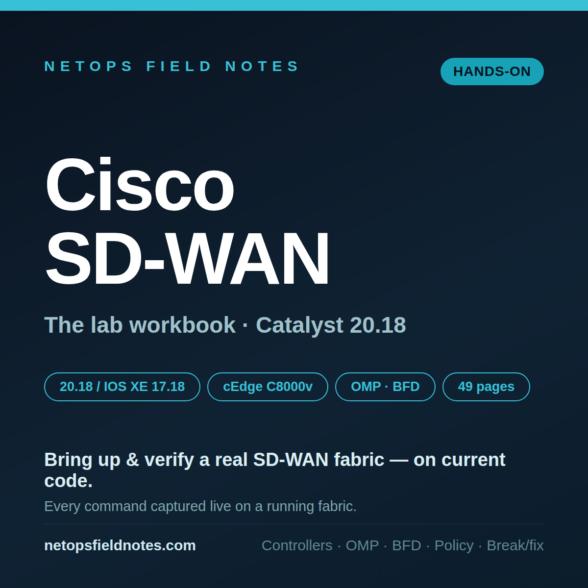
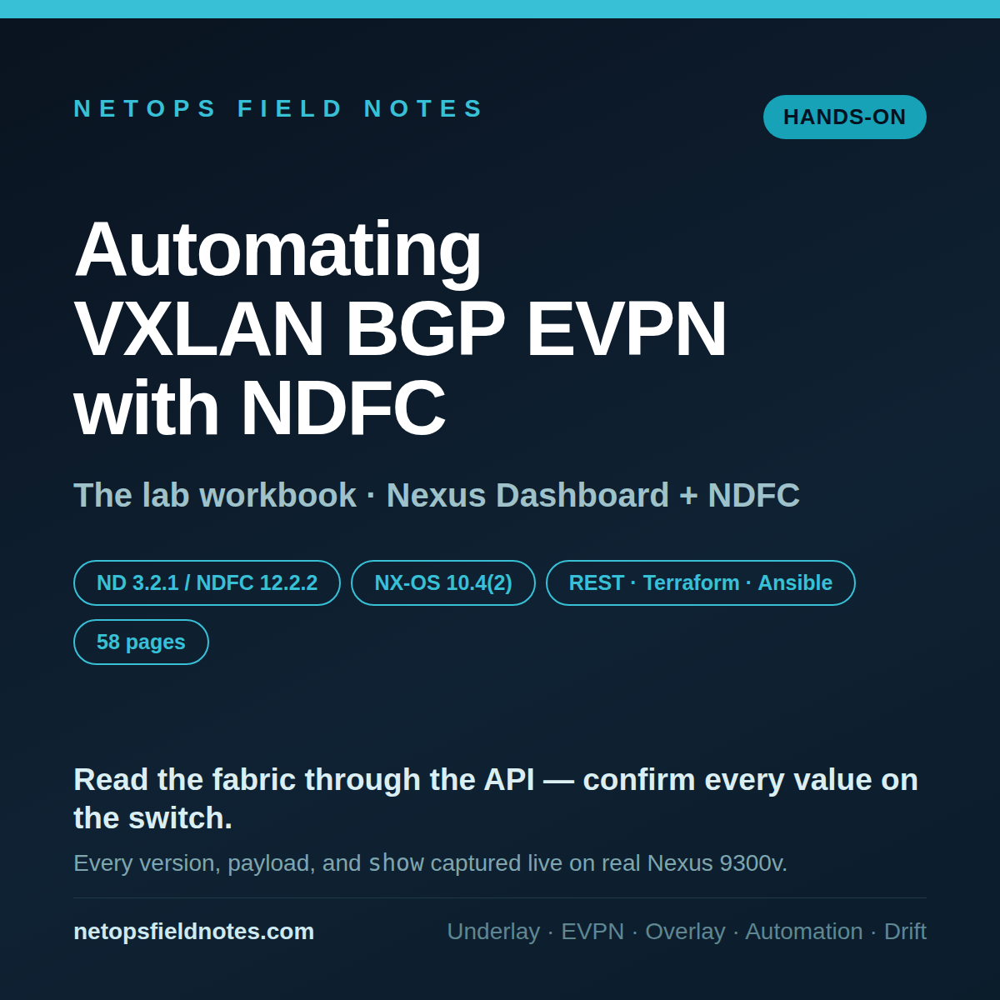
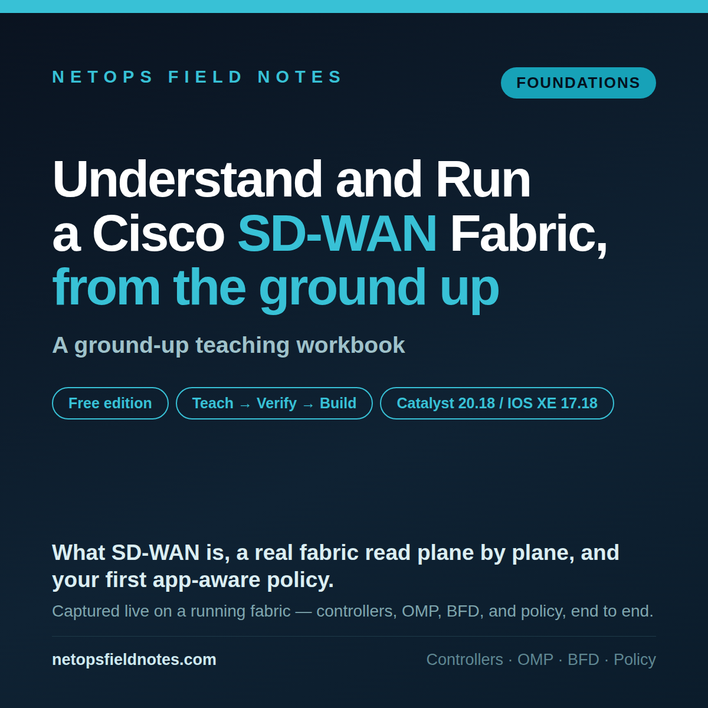
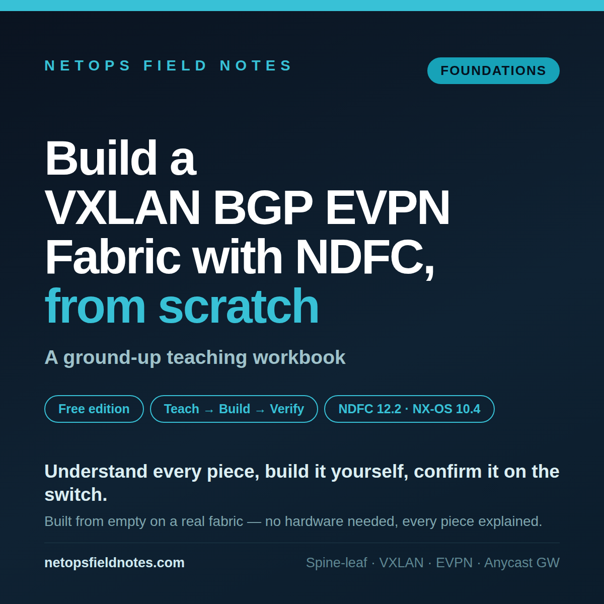

# NetOps Field Notes — Free Workbooks

Four hands-on lab workbooks for network and data-center engineers. Every command,
API call, and screen in these books was **captured live on a running fabric** —
Cisco DevNet sandboxes on current code — then written up the way an engineer would
actually work through it: build something, read what the platform did, confirm it
on the device.

They're free. Read them, use them, share them unchanged.

| Workbook | Pages | Lab bench | Download |
|---|---|---|---|
| **Cisco SD-WAN** — controllers, OMP, BFD, templates, policies, break/fix | 49 | Catalyst SD-WAN 20.18 / IOS XE 17.18 (cEdge C8000v) | [PDF](Cisco-SD-WAN-Workbook.pdf) |
| **Automating VXLAN BGP EVPN with NDFC** — REST, Terraform, Ansible, config-drift | 58 | ND 3.2.1 / NDFC 12.2.2, NX-OS 10.4(2) (Nexus 9300v) | [PDF](Automating-VXLAN-BGP-EVPN-with-NDFC-Workbook.pdf) |
| **Understand and Run a Cisco SD-WAN Fabric — Foundations** — what SD-WAN is, from the ground up | 49 | Catalyst SD-WAN 20.18 | [PDF](Understand-and-Run-a-Cisco-SD-WAN-Fabric-Foundations.pdf) |
| **Build a VXLAN BGP EVPN Fabric with NDFC — Foundations** — empty controller to working fabric | 51 | ND 3.2.1 / NDFC 12.2.2 | [PDF](Build-a-VXLAN-BGP-EVPN-Fabric-with-NDFC-Foundations.pdf) |

  
  
  
  

## What "captured live" means

- The captures come from real, running systems — a live SD-WAN fabric and a live
  Nexus Dashboard / NDFC fabric — not from documentation or memory.
- Real output includes the rough edges: failures, quirky defaults, and the
  honest gotchas (version drift, template drift, virtual-vs-hardware limits) are
  called out in each book's fine print.
- The lab benches are **virtual** DevNet devices. Management-plane, API, and
  workflow behavior transfers to physical gear; hardware-specific behavior
  (dataplane scale, TCAM, performance) does not — the books say so explicitly.

## More

- Site: [netopsfieldnotes.com](https://netopsfieldnotes.com) · Books page with
  Gumroad mirrors: [netopsfieldnotes.com/books](https://netopsfieldnotes.com/books/)
- Free field guides (7–11 page shorts): [netopsfieldnotes.com/guides](https://netopsfieldnotes.com/guides/)

## About the author

James Son is a network, security, and automation engineer with 20+ years across
U.S. federal agencies and Fortune 100 enterprises.

## The fine print

© 2026 James Son. All rights reserved. The PDFs may be shared **unchanged and in
full**; they may not be modified, excerpted for republication, or sold. Provided
as-is, without warranty of any kind; nothing here is professional advice — test
against your own devices and code versions before applying anything in
production. Cisco, IOS XE, Nexus, NDFC, and related marks are trademarks of
Cisco Systems, Inc. This is an independent publication, not affiliated with or
endorsed by Cisco.
